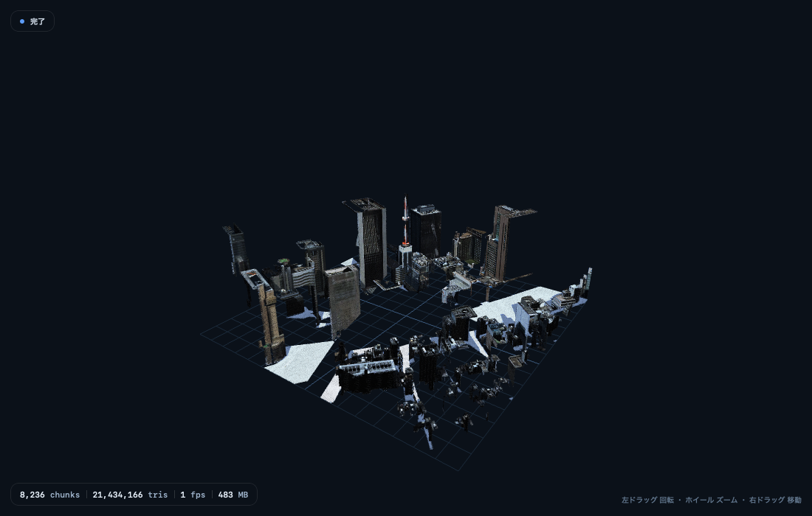

# S3DV viewer 1.1

`.s3dv`（S3DP パケットを時系列で格納した録画コンテナ）を再生・検証する macOS アプリ。
録画を**メモリマップしたまま**自前のループバック HTTP/WebSocket サーバーから
WKWebView 内の three.js へ流し込み、**数千万三角形**のストリームでも落ちずに
操作できることを目標にしている。

```
┌────────────┐   mmap + 遅延読み出し   ┌──────────────┐   WebSocket    ┌──────────────┐
│ .s3dv file │ ─────────────────────▶ │ ReplayEngine │ ─────────────▶ │  WKWebView   │
│  (1.27 GB) │   1パケットずつ         │  pacing,     │   binary       │  viewer.js   │
└────────────┘   （全読みしない）      │  budget      │   S3DP         │  batching    │
                                      └──────────────┘                └──────────────┘
                                             ▲  JSON text: pause/step/seek/speed
                                             └──────────────────────────────────────
```

- **アプリ名**: S3DV viewer（bundle id `com.s3dv-research.s3dv-viewer`）
- **バージョン**: 1.1.0
- **対応**: macOS 13 以降（検証機は macOS 27.0.1 / M1 Max / 64 GB）
- **配布**: `dist/S3DV-viewer-1.1.0.dmg`（ad-hoc 署名・notarization なし）



---

## 1. インストール

```bash
open apps/s3dv-viewer/dist/S3DV-viewer-1.1.0.dmg
#  Finder のウィンドウでアイコンを Applications へドラッグ
```

初回起動は Gatekeeper の警告が出る（notarization していないため）。次のどちらかで開く。

1. Finder でアプリを右クリック →「開く」→「開く」
2. `xattr -dr com.apple.quarantine "/Applications/S3DV viewer.app"`

`.s3dv` をダブルクリックすると本アプリが関連付けられて開く。

---

## 2. 画面

### ホーム

ドロップ領域、最近開いたファイル、リモートストリームの接続欄、現在の設定の要約。
`.s3dv` をウィンドウへドラッグしても開ける。

### スタジオ（再生画面）

| 領域 | 内容 |
|---|---|
| ヘッダ | ファイル名 / サイズ / 状態 / 予算モード表示 |
| 3Dビュー | `viewer.js`（標準）または `main.js`（研究パリティ） |
| 右インスペクタ | ストリーム統計・描画統計・メモリ予算・ソースmetadata・コンソール |
| トランスポート | 再生/一時停止・1パケット送り・先頭から・シーク・速度・ループ・転送量 |

### 設定（⌘,）

5つのタブ（配信 / 描画 / メモリ / ネットワーク / 詳細）に、すべてのストリーミング設定を置く。
全項目は §4。

### キーボード

| 操作 | ショートカット |
|---|---|
| 録画を開く | ⌘O |
| 同梱デモ | ⇧⌘D |
| 再生 / 一時停止 | Space |
| 1パケット進む | `.`（一時停止中のみ） |
| 先頭から再生 | ⌘R |
| ワイヤーフレーム | ⇧⌘W |
| 視点リセット（自動フィット） | ⇧⌘V |
| 設定 | ⌘, |
| ログフォルダ | ⇧⌘L |

---

## 3. CLI — 起動中はすべてコマンドラインから

アプリは起動時に UNIX ソケット（`~/Library/Application Support/S3DV viewer/control.sock`）を
開く。バンドル同梱の `s3dvctl` がそこへ 1 行 1 リクエストで話しかけるので、**GUI でできる
操作はすべてシェルから実行できる**。ポートは開かない（ソケットのみ・同一 uid のみ）。

```bash
CTL="/Applications/S3DV viewer.app/Contents/MacOS/s3dvctl"   # PATH へは scripts/install_cli.sh

$CTL status                       # 再生状態・統計・ポート
$CTL open path=~/runs/tdt_fuse/prod_gt.s3dv
$CTL pause && $CTL step && $CTL seek t=0 && $CTL play
$CTL set rate 0.5
$CTL set budget 384
$CTL presentation framecomplete   # 提示モード（framecomplete|immediate、ライブ切替）
$CTL set applybudgetms 10         # フレーム完全モードの適用予算（1–50 ms）
$CTL bench 20 --json              # gl.finish() 同期の ms/frame
$CTL screenshot path=/tmp/city.png
$CTL wait timeout=600             # 完了待ち（タイムアウトは exit 4）
$CTL quit
```

`set <key> <value>` は設定タブの全項目をカバーする（`rate` `loop` `pacingCap`
`autoReconnect` `reconnectAttempts` `renderer` `presentation` `applyBudgetMs`
`wireframe` `grid` `hud` `pixelRatio`
`textureQuality` `budget` `evictionPolicy` `arenaVertices` `httpPort` `wsPort`
`maxClients` `deepVerify` `telemetryHz` `remoteURL` `sourceMode` …）。
`s3dvctl help` が全コマンドを返す。終了コードは 0 成功 / 1 サーバーエラー /
2 使い方 / 3 未起動 / 4 `wait` タイムアウト。

検証は `scripts/verify_cli.sh`（実アプリを起動して 21 項目を検査）。
詳細は [`docs/25_S3DV_viewer_CLI.md`](../../docs/25_S3DV_viewer_CLI.md)。

---

## 4. できること

- ローカル `.s3dv` の再生、同梱デモ、**リモート `s3dv serve` への直接接続**
- 再生速度 0.05–16×、ループ、開始時一時停止、ペーシング上限の変更
- ページからの **pause / step / seek / speed**（JSON制御チャネル。サーバー側で本当に動く）
- シークは直前の `SNAPSHOT_BEGIN` へアンカー（`container.py` の `checkpoint_at` と同一）
- 描画モード切替（バッチ描画 / 研究パリティ）
- **常駐ジオメトリ予算**（1/2/4 GB・無制限）と空間/LRU退避
- ワイヤーフレーム、グリッド、HUD、解像度上限、テクスチャ品質
- ループバックのポート固定（0=自動）、同時クライアント数
- 深いCRC検証（オプション）、テレメトリ更新レート
- クラッシュログ、描画プロセス死亡からの自動復帰、メモリ圧迫時の自動縮小
- **CLI（`s3dvctl`）から全操作** — 起動中は GUI と同じ入口をシェルから叩ける

---

## 5. 設定リファレンス

### 配信

| 設定 | 既定 | 意味 |
|---|---|---|
| 入力 | ローカル | ローカル / 同梱デモ / リモート `s3dv serve` |
| リモートURL | `ws://127.0.0.1:8765` | 直接接続する WebSocket |
| 速度 | 1.0× | 0.05–16×。`server.py` と同じ「次パケットの間隔」に適用 |
| ループ再生 | off | 終端で先頭へ |
| 開始時に一時停止 | off | 最初のパケットで止める |
| ループ間隔 | 0.75 s | ループ時の待機 |
| 最大待機 | 2.0 s | 1パケットあたりのペーシング上限（既定はキット実装と同一） |
| 制御チャネル | on | ページからの pause/step/seek/speed を許可 |
| 自動再接続 | on | ページ側の切断リトライ |
| 再接続の試行回数 | 3 | 待機は 0.5 秒から倍々（最大 8 秒） |

### 描画

| 設定 | 既定 | 意味 |
|---|---|---|
| レンダラ | 標準（バッチ） | 標準 = 1ドローコール/アリーナ。パリティ = キットの `main.js` をバイト一致実行 |
| 提示モード | フレーム完全（既定） | 下記「フレーム完全提示」参照。即時 = 研究キットと同じ動作 |
| 適用予算 | 6 ms | フレーム完全モードで1描画tickに適用に使える時間（1–50 ms） |
| ワイヤーフレームで開始 | off | |
| グリッド床 | on | シーン規模に自動スケール |
| ビュー内HUD | on | 左下の小さな統計（提示/落としたフレーム数も表示） |
| 解像度上限 | 2× | devicePixelRatio の上限 |
| テクスチャ品質 | 100% | |

## フレーム完全提示（v1.2.0）

標準レンダラでは、受信したフレームを**そのまま即座にシーンへ適用しません**。
いったん受信箱にためて、描画tickの中で順序どおり**完全に**適用してから、
その完全な状態を1回だけ描画（提示）します。

```
受信(検証) ─▶ 受信箱 ─▶ tick: 予算内で順次完全適用 ─▶ 変化があれば1回だけ render ─▶ 次のtick
```

このため**画面に出るフレームは常に「そのパケット境界での完全なシーン状態」**です。
スナップショットの半分だけ適用された状態や、テクスチャ適用途中の状態が表示されることはありません。

負荷が高く1tickで適用しきれない場合は、適用を打ち切って**中間フレームを落とします**
（後から来る完全な状態だけを提示。ロード時間を取る代わりにフレーム数を減らす）。
テクスチャはデコードが完了してからシーンに組み込まれるため、白い未完成フレームも出ません。

- **提示 / 落としたフレーム**: HUD とインスペクタに表示。`落とした` は適用したが個別提示しなかった中間状態の数。
- **未適用バックログ**: まだ適用されていない受信フレーム数。通常は一時的で、再生終了時に0に戻ります。
- **適用予算**: 大きいほど再生が速く進みフレームは減る、小さいほどロード時間を取り滑らかに見える。
- **非表示ウィンドウ**: 提示するものがないため、到着時に即適用します（ペーシングは無意味）。
- **即時モード**: 従来動作（受信即適用・rAF時にある状態を描画）への切り替え。A/B比較・障害解析用。
  `s3dvctl presentation framecomplete|immediate` でも切替可能（ライブ、再読み込みなし）。

パリティレンダラ（研究キット比較用）は意図的にこの変更を含みません。

### メモリ

| 設定 | 既定 | 意味 |
|---|---|---|
| 常駐ジオメトリ予算 | 2.0 GB | 超えたら退避。無制限は非推奨（描画プロセスは約4GBで落ちる） |
| 退避ポリシー | 空間的 | 中心から外側へ / LRU |
| 1アリーナの頂点数 | 4,000,000 | 大きいほどドローコール減・メモリ増 |
| メモリ圧迫時に自動縮小 | on | 予算を60%へ、ページにも通知 |

### ネットワーク

| 設定 | 既定 | 意味 |
|---|---|---|
| HTTPポート | 0（自動） | 固定すると外部ブラウザからも同じページを開ける |
| WebSocketポート | 0（自動） | |
| 同時クライアント | 1 | 2本目以降は拒否（同一ストリームの多重配信を防ぐ） |

待ち受けは**常に 127.0.0.1**。外部公開はしない。

### 詳細

深いCRC検証（開くときに全レコードを検証）、起動時に前回のファイルを復元、テレメトリ更新 Hz、
ログフォルダ、設定の初期化。

---

## 6. 設計

### 5.1 遅延読み出し（メモリの主対策）

`S3DVRecording` は `Data(contentsOf:options:.alwaysMapped)` でファイルを**マップするだけ**で、
パケットは `wire(at:)` で1件ずつ取り出す。インデックスは 1 パケット 1 行（24 B）なので
24,494 パケットでも約 590 KB。

以前の実装は `readFrames()` で全レコードを `Data` の配列へコピーしており、1.27 GB の録画で
**RSS 4.19 GB** まで膨らみ、しかも終端でソケットを即座に切っていたため
**24,494 パケット中 17,621（71.9%）しかクライアントに届いていなかった**。

### 5.2 予算ガバナ（ネイティブ側）

`BudgetGovernor` はメッシュヘッダ（`n`, `ni`）だけから常駐バイト数
`36 B/頂点 + 4 B/インデックス` を推定し、予算を超えたら退避する。

- 退避は `CHUNK_REMOVE` を**合成**して送る（プロトコル上正規の操作）
- パケットを挿入・削除すると連番が飛ぶため、その時点から**連番を正規化**する
- 予算内なら**何も落とさない**（この不変条件は回帰テストで固定）

### 5.3 バッチ描画（巨大モデル対策）

`viewer.js` はチャンクを 4M 頂点のアリーナへ詰め、**アリーナごとに 1 ドローコール**で描く。
8,236 チャンクの東京ストリームは **10 ドローコール**（アリーナ9 + グリッド1）。
キットの `main.js` は 1 チャンク 1 メッシュなので 8,236 ドローコール。

- 解放範囲はフリーリストで再利用し、断片化が 1.6 倍を超えたら `copyWithin` で
  アリーナ内を詰める（元データを保持しない in-place コンパクション）
- `CHUNK_REPLACE` は旧リビジョンの範囲を**先に解放**してから挿入する
- 予算はビューア側でも独立に監視する（二重の防御）
- カメラはシーンのバウンディングボックスへ**自動フィット**（1 m のデモと 300 m の都市を同じコードで扱う）
- テクスチャ付きチャンクは最初の `TEXTURE_UPDATE` でアリーナから自前メッシュへ昇格する

### 5.4 クラッシュ安全

- `WKWebView` の描画プロセス終了を検知して**自動復帰**（最大2回、まず予算を「軽量」へ）
- `NSSetUncaughtExceptionHandler` で例外をログ（シグナルハンドラは使わない — 破損スタックでの
  ロック取得はデッドロックの元）
- 起動時にセンチネルを書き、正常終了で消す。次回起動時に「前回は異常終了」を記録
- 設定JSONが壊れていたら退避して既定値へ（壊れた内容は `settings-corrupt-*.json` に保存）
- ログは `~/Library/Logs/S3DV viewer/session.log`（1 MB でローテート）

### 5.5 リーク対策

- コンソールは 200 件のリング（ERROR のみ別枠）
- テレメトリは**ポーリング**（パケットごとに JS→native 通知しない）
- `closeSession()` でセッション・サーバー・タイマーを止め、WebView を `about:blank` に
  差し替えて WebGL のシーン・ジオメトリ・テクスチャを解放
- リピート再生で1周あたりのフットプリント増加を測る自動テスト（`S3DV_VIEWER_REPEAT`）

---

## 7. 実測

`scripts/verify_app.sh` の実行結果（`runs/viewer_verify/`）。
検証セッションには画面が接続されておらず `document.hidden = true` のため rAF は
WebKit に ~1 Hz へ絞られる。そのため `fps` は参考値で、`benchFrameMS`
（`gl.finish()` で同期した実フレームコスト）を性能の指標にしている。

| ケース | 判定 | 適用÷送信フレーム | 常駐チャンク※ | 常駐三角形※ | 退避 | アプリ最大MB | bench ms/frame | 秒 |
|---|---|---|---|---|---|---|---|---|
| デモ（標準・バッチ） | ✅ | 34/34 | 8 | 1,557 | 0 | 29 | 4 | 6 |
| デモ（研究パリティ） | ✅ | 34/34 | 8 | 1,557 | 0 | 30 | — | 4 |
| 東京 const 244 MB | ✅ | 3,655/3,655 | 2,407 | 8,252,336 | 0 | 31 | 14 | 7 |
| 東京 GT 1.27 GB（予算2GB） | ✅ | 24,494/24,494 | 8,236 | 21,434,166 | 0 | 44 | 33 | 37 |
| 東京 GT 1.27 GB（予算384MB） | ✅ | 34,021/34,021 | 4,860 | 12,871,110 | 9,527 | 47 | 26 | 32 |
| 東京 model 1.33 GB | ✅ | 23,033/23,033 | 7,847 | 22,401,636 | 0 | 44 | 36 | 68 |
| リーク（10周） | ✅ | 3,655/3,655 | 2,407 | 8,252,336 | 0 | 35 | 14 | 155 |

### 0.1.0 との比較（同一ファイル・同一マシン）

| | 0.1.0 | 1.0.0 |
|---|---|---|
| `prod_gt`（1.27 GB）適用パケット | 17,621 / 24,494（**71.9%**） | **24,494 / 24,494** |
| アプリのフットプリント | 4,190 MB（RSS） | **44 MB** |
| ドローコール（8,236 チャンク） | 8,236 | **10**（アリーナ9 + グリッド1） |
| 所要時間（1.27 GB の一括投入） | 61 s（打ち切り） | **25–37 s** |

### フレームコスト

`bench` は `gl.finish()` で GPU を同期した実フレームコスト。2,143万三角形の全表示で
**24–38 ms/frame**（≒26–40 fps、M1 Max / 1100×700）。デモ（1,557 三角形）は 4 ms、
const（825万三角形）は 16 ms。**同じマシンでも同時負荷で2倍以上振れる**ので、
桁を主張するときは余裕を見るべきである。

### メモリ

- アプリのフットプリントは全ケースで **29–48 MB**。`/usr/bin/time` の max RSS が
  1.4 GB になるのは 1.27 GB の録画を読み取り専用で mmap しているため
  （`task_vm_info.phys_footprint` は 44 MB）。
- ビューア側の GPU バッファは**割当**で 816 MB、**実データ**で 481 MB（2,143万三角形）。
  アリーナは録画の頂点数から自動サイズするので、1,557 三角形のデモは 14 MB で済む。
- 同一録画 10 周で **−0.46 MB/周**（30.8 → 26.2 MB、ピーク 30.8 MB）。
  判定条件に「5 MB/周を超えたら fail」を入れてある。

### 異常系

| 入力 | 結果 |
|---|---|
| 1 MB に切り詰めた `.s3dv` | 起動を拒否（`Invalid index offset`）、exit 3、クラッシュなし |
| `.s3dv` でないファイル | 起動を拒否（`Invalid S3DV file header`）、exit 3 |
| 描画プロセスの強制終了 | 検知して自動復帰（最大2回、予算を「軽量」へ） |
| 制御フレーム（pause/step/seek/resume） | `S3DV_VIEWER_CONTROL_SMOKE=1` で自動実行し、`phase=paused` と再開をログで確認 |

---

## 8. 自己検証

```bash
cd apps/s3dv-viewer
DEVELOPER_DIR=/Applications/Xcode.app/Contents/Developer swift test
./scripts/build_app.sh
./scripts/verify_app.sh            # 全ケース（--quick で demo + 244MB のみ）
./scripts/verify_cli.sh            # CLI制御（実アプリ起動→21項目）
./scripts/make_dmg.sh              # dist/S3DV-viewer-<ver>.dmg
./scripts/verify_dmg.sh            # マウントして検証
```

環境変数（`AutotestController.swift`）:

| 変数 | 意味 |
|---|---|
| `S3DV_VIEWER_AUTOTEST=1` | 自動テスト有効（終了コードで判定） |
| `S3DV_VIEWER_REPORT=path` | JSON レポート出力先 |
| `S3DV_VIEWER_EXPECT='{...}'` | 期待値（packets/chunks/triangles/bytes） |
| `S3DV_VIEWER_RATE` / `_MODE` / `_BUDGET_MB` | 上書き（保存はしない） |
| `S3DV_VIEWER_SETTLE_MS` | 終端後に落ち着くまで待つ時間 |
| `S3DV_VIEWER_REPEAT` | 同じ録画を N 周して 1 周あたりのメモリ増を測る |
| `S3DV_VIEWER_SOAK_SECONDS` | N 秒動かして計測（長時間テスト） |
| `S3DV_VIEWER_NO_RENDER=1` | 描画を止めて転送・適用だけを測る |
| `S3DV_VIEWER_SHOT` | WebView のスクリーンショット |

終了コード: **0** 一致 / **3** 不一致・起動失敗 / **4** タイムアウト。

---

## 9. ビルド

```bash
cd apps/s3dv-viewer
DEVELOPER_DIR=/Applications/Xcode.app/Contents/Developer swift build -c release
./scripts/build_app.sh      # build/S3DV viewer.app
./scripts/make_dmg.sh       # dist/S3DV-viewer-1.1.0.dmg
```

`scripts/sync_web.sh` はキット `web/main.js` と `web/index.html` をハッシュ pin で
取り込む（研究パリティ用）。`viewer.html` / `viewer.js` はアプリ固有で対象外。

---

## 10. 既知の制限

- **ad-hoc 署名・notarization なし**。初回起動は右クリック→「開く」か quarantine 解除。
- **標準レンダラは頂点色のみ**。`TEXTURE_UPDATE` は受けてチャンクを自前メッシュへ昇格するが、
  テクスチャ投影が研究用パリティ（`main.js`）とピクセル単位で一致することは保証しない。
  テクスチャ付き録画の厳密な再現が必要なら描画タブで「研究パリティ」を選ぶ。
- **リモート接続時はタイムライン無効**（`/metadata` がクロスオリジンになるため）。
- 予算を超えるストリームでは**一部のチャンクが表示されない**（意図した動作。退避数はインスペクタに出る）。
- 1 本のストリームは S3DV の chunk index 仕様により **±204 m**（chunk ±32 × 16³ voxel）が上限。
- 画面が接続されていない環境では rAF が絞られ、fps は実力を反映しない（§6 の注記）。
- 回転・ズームは three.js の `OrbitControls`。ピンチ操作には未対応。

---

## 11. ライセンスとクレジット

- 本アプリ: S3DV research kit（研究用途）
- 描画: [three.js](https://threejs.org) r180 — MIT
- 東京の3Dデータ: **Project PLATEAU**（国土交通省）／東京都デジタルツイン基盤 —
  CC BY 4.0 互換。原典 https://www.mlit.go.jp/plateau/
- 録画ファイル自体は再配布していない（`data/` と `runs/` は `.gitignore`）
